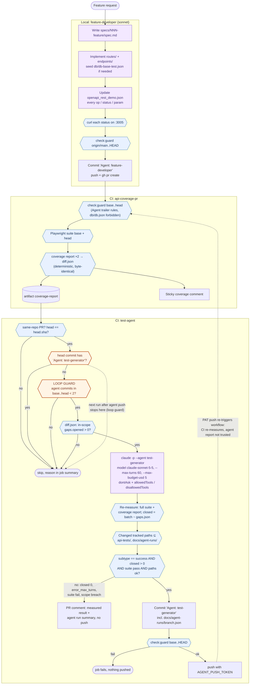

# Day 4 – Multi-agent pipeline

Two agents, one workflow. The **feature-developer** agent (local, `.claude/agents/feature-developer.md`) ships an endpoint with its spec and OpenAPI, but no tests. The **test-generator** agent runs headless in CI (`test-agent` job in `.github/workflows/api-coverage.yml`) and closes the in-scope gaps the PR opened.

Deterministic code makes every decision. The agents only produce diffs: CI measures them, gates them and enforces the rules on them.

## Flow

Legend: blue hexagons = deterministic checks; orange = loop guard; purple = LLM steps.

## Deterministic checks

| # | Where | Check | On failure |
|---|---|---|---|
| 1 | feature-developer | curl each documented status on :3005 | agent reports mismatch, doesn't drop the status |
| 2 | feature-developer, api-coverage-pr, test-agent | `check:guard` over the commit range: `Agent: test-generator` may only touch `api-tests/`, `docs/agent-runs/`; `Agent: feature-developer` never touches `api-tests/`, `coverage-tool/`, `.github/`; nobody commits `db/db.json` | job fails |
| 3 | api-coverage-pr | Playwright suite (head), coverage report base + head, `diff` | job fails / diff published |
| 4 | test-agent gate | same-repo PR (secrets), head not moved past `head.sha` | skip |
| 5 | test-agent gate | **loop guard**: head commit carries `Agent: test-generator` → skip; ≥ 2 such commits in `base..head` → skip | skip |
| 6 | test-agent gate | batch = `diff.json` `gaps.opened` with `inScope: true`; empty → skip | skip |
| 7 | test-agent | agent result `subtype` from `--output-format json` (`success` / `error_max_turns` / `error_max_budget_usd` / …) | comment, no push |
| 8 | test-agent | CI re-runs the full suite and `coverage:report`; `closed` = batch ids missing from the new `gaps.json` | `closed == 0` or suite fail → comment, no push |
| 9 | test-agent | tracked changes only in `api-tests/`, `docs/agent-runs/` (`db/db.json` restored first) | job fails, comment |
| 10 | test-agent | `check:guard base..HEAD` after commit, before push | job fails, nothing pushed |
| 11 | next workflow run | push via PAT re-triggers `api-coverage-pr`: CI re-measures from scratch | normal coverage result |

### Why the loop terminates
Run N+1 is triggered by the agent's push, so its head commit carries `Agent: test-generator` and the gate skips (check 5). A human push after that can re-arm the agent once more. The `< 2` agent-commits rule caps it at two agent commits per PR, whatever happens.

## Headless agent: permission layers
1. `--permission-mode dontAsk` + `--permission-prompts none`: anything not explicitly allowed is denied, and nobody is asked.
2. `--allowedTools`: `Read Glob Grep`, `Edit(/api-tests/**)`, `Edit(/docs/agent-runs/**)` (Edit rules also cover Write), plus a fixed list of exact Bash commands (`npm --prefix api-tests test …`, `npm run coverage:report`, `git status --porcelain`, …). There's no `node -e`: the agent reads `gaps.json` with Read/Grep.
3. `--disallowedTools`: `Agent WebFetch WebSearch mcp__*`, `Edit()` on every protected tree (`endpoints/ routes/ server.js public/ coverage-tool/ .github/ db/ .claude/ scripts/ specs/ CLAUDE.md package*.json`), and `git add/commit/push/reset/checkout/config`, `gh`, `curl`, `wget`, `node`, `npx`, `npm start`, `rm`, `env`, `printenv`. Deny is evaluated before allow, so the project `.claude/settings.json` allow rules (`git push *`, `gh pr create *`) can't reopen them.
4. `persist-credentials: false` keeps no token in `.git/config`. `AGENT_PUSH_TOKEN` exists only in the push step's env, and `ANTHROPIC_API_KEY` only in the agent step's env.
5. Steps 9 and 10 (path check, `check:guard`) are the final enforcement. A Bash command that writes files can sidestep Edit rules, and these steps catch that.

Design choice: the agent writes the tests and `docs/agent-runs/<branch>.json`, and the **workflow** makes the commit (trailer `Agent: test-generator`), runs `check:guard` and pushes. This keeps the push token out of the agent's environment and matches `test-generator.md` ("the caller owns git").

## Verified CLI flags (Claude Code 2.1.319)
Checked against `claude --help` and https://code.claude.com/docs/en/cli-reference:
`-p`, `--agent`, `--model`, `--max-budget-usd`, `--permission-mode dontAsk`, `--permission-prompts none`, `--no-session-persistence`, `--output-format json`, `--allowedTools`, `--disallowedTools` (variadic, so the prompt is passed first). `--max-turns` is in the docs ("Limit the number of agentic turns (print mode only)") but is **not listed by `--help`**. On the limit, the result has `subtype: "error_max_turns"` and the process exits non-zero (docs: agent-sdk/agent-loop). Path rules: `/path` in CLI rules anchors at the working directory (repo root in CI). The CLI version is pinned in `CLAUDE_CODE_VERSION`.

## Known limitation: `opened` vs `added`
The batch uses `gaps.opened` as specified. In `coverage-tool/src/diff.js`, *opened* means "covered in base, gap in head" (a regression). A brand-new operation from feature-developer appears in `gaps.added` instead. As written, the job won't fire on a pure new-endpoint PR. To cover those, change the gate filter to `[...d.gaps.opened, ...d.gaps.added]`.

## Secrets
| Secret | Used in | Minimal permissions |
|---|---|---|
| `ANTHROPIC_API_KEY` | `Run test-generator headless` step only | Claude Console API key in a dedicated workspace with a monthly spend limit |
| `AGENT_PUSH_TOKEN` | `Commit, check:guard, push` step only | Fine-grained PAT, **this repository only**: `Contents: Read and write` (push), `Metadata: Read` (mandatory). Nothing else: no Workflows permission, so it can't push `.github/workflows` changes. Short expiry. |

`GITHUB_TOKEN` (automatic) posts the PR comment (`pull-requests: write` on the job).
